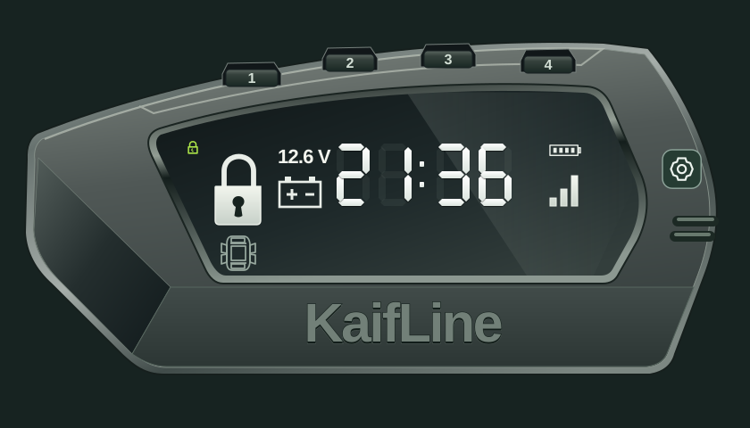
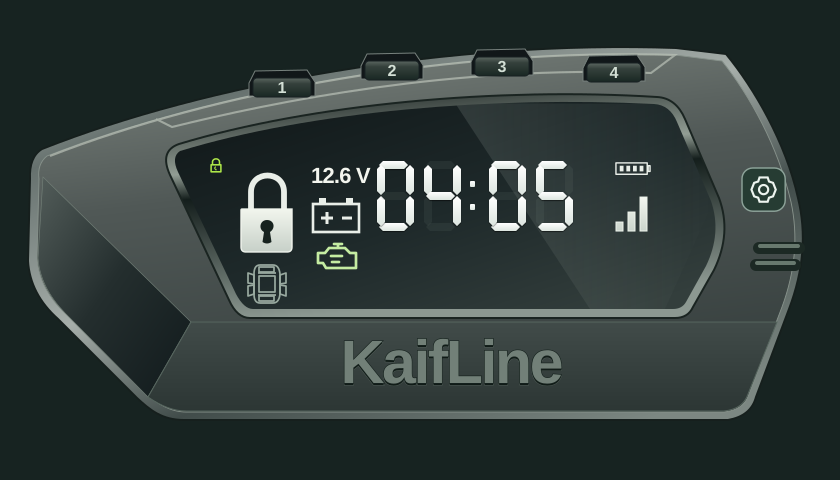

# KaifLine Alarm

Сигнализация для BeamNG.drive · Тестовая версия 0.5.74

  
  &nbsp;
  

[Скачать мод](KaifLine_Alarm_0.5.74.zip) · [Установка](#установка) · [Управление](#управление) · [Совместимость](#совместимость)

KaifLine добавляет в машину сигнализацию с брелком Horizon. С него можно включить охрану, запустить и остановить двигатель, открыть багажник или найти автомобиль на парковке. Брелок показывает состояние замков, открытые зоны и работу двигателя.

В этой сборке оставлен Horizon. Оформление Classic и управление с телефона пока исключены: они ещё в разработке.

## Возможности

- Охрана дверей, капота и багажника, датчики удара и наклона.
- Автозапуск с авторизацией водителя. Если охрана была снята до запуска, можно ехать без повторного открытия. При запуске под охраной требуется авторизация.
- Keyless через внешние ручки при установленном дополнительном модуле.
- Выбор машины, если сигнализация установлена на нескольких автомобилях. При посадке брелок переключается на выбранный автомобиль.
- Русский и английский интерфейс. Брелок можно перетаскивать во время игры.
- Игровые часы, индикаторы связи и работы двигателя. Во время автозапуска часы чередуются с оставшимся временем.
- Приветственный свет на 30 секунд при отпирании в темноте. После начала движения свет остаётся включённым до ручного переключения или постановки на охрану.
- Отдельная подсветка номера при открытии багажника с брелка. После закрытия крышки её ручка снова блокируется.

Если оставить заведённую машину на ручнике и нажать кнопку постановки на охрану, она запрётся, а через секунду двигатель заглохнет. Функция работает на неподвижном автомобиле.

Как выглядит брелок во время автозапуска

На изображении показан интерфейс текущей сборки с демонстрационными значениями. Это иллюстрация интерфейса, а не скриншот из игры.

## Установка

1. Скачайте **[KaifLine_Alarm_0.5.74.zip](KaifLine_Alarm_0.5.74.zip)** и поместите его в папку `mods` пользовательского каталога BeamNG.drive. Распаковывать архив не нужно.
2. Удалите предыдущую версию KaifLine. Две редакции мода одновременно устанавливать нельзя.
3. В конфигурации автомобиля выберите **KaifLine Alarm** в слоте дизайна номерного знака. Дизайн самого номера выбирается во вложенном слоте.
4. Добавьте приложение **KaifLine Keyfob** через редактор UI-приложений игры.
5. Для работы Keyless установите соответствующий модуль во вложенном слоте сигнализации.

Кнопка с шестерёнкой на брелке открывает настройки языка. Если раньше был выбран Classic, эта редакция автоматически переключит оформление на Horizon.

## Управление

Короткое нажатие: нажать и отпустить. Длительное: удерживать **0,9 секунды до сигнала**. Стрелка `→` означает последовательное нажатие: отпустите первую кнопку, затем нажмите вторую. Одновременно зажимать их не нужно.

| Действие | Кнопки |
| --- | --- |
| Включить охрану | Коротко **1** |
| Снять охрану | Коротко **2** |
| Проверить состояние машины | Коротко **3** |
| Подсветить дисплей | Коротко **4** |
| Запустить двигатель | Удерживать **1** в сумме **1,8 с** |
| Продлить автозапуск на 5 минут до авторизации | Повторить комбинацию запуска |
| Остановить двигатель | Длительно **1** → коротко **4** |
| Открыть багажник | Длительно **2** → коротко **1** |
| Найти автомобиль | Дважды коротко **4** |
| Поставить на охрану без звука подтверждения | Длительно **1** → коротко **1** |
| Снять охрану без звука подтверждения | Длительно **2** → коротко **2** |
| Включить режим бесшумной охраны | Длительно **1** → коротко **2** |
| Переключить уровни датчика удара | Дважды коротко **1** |
| Включить или выключить датчик наклона | Дважды коротко **3** |

При запуске без ручника брелок предупреждает о риске движения. Чтобы подтвердить запуск, повторите комбинацию автозапуска.

После команды **1 → 4** звук остановки прозвучит, когда обороты упадут до нуля и пройдёт ещё **500 мс**. При начале движения авторизованной машины брелок через секунду подаст четыре быстрых писка. Сигнал звучит один раз за авторизацию.

## Совместимость

Мод разрабатывается для **BeamNG.drive 0.40**. Работа отдельных функций зависит от контроллеров конкретного автомобиля. Для Skoda Octavia IV предусмотрен отдельный адаптер; файлы автомобильного мода не изменяются.

На сторонних машинах могут отличаться замки, датчики открытых зон и подключение ламп номера. Совместимость со всеми автомобилями не гарантируется. Крытая парковка определяется по перекрытию над машиной, поэтому приветственный свет может включаться и на освещённой парковке. Заряд батарейки самого брелка моделируется интерфейсом.

Если нашли ошибку, создайте **Issue**. Укажите версию игры, автомобиль и действия для повторения ошибки. Приложите `beamng.log`, а для стороннего автомобиля — ссылку на его мод.

## Исходники

[Скачать исходники версии 0.5.74](KaifLine_Source_0.5.74.zip). В архиве находятся код мода, тесты и скрипты сборки. Инструкция по сборке находится в README внутри архива.

Сведения о звуковых ресурсах и их лицензировании: [ASSETS.md](ASSETS.md).
